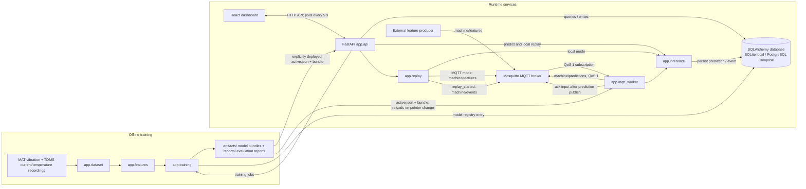

# Architecture and operating boundaries

## Runtime and data-flow diagram

The dashboard uses HTTP endpoints on the API; it does not subscribe to MQTT or read
the database directly. The API reads prediction/event history from the configured
database and reads model evaluation from `reports/latest.json`. MQTT replay passes
through the broker and worker, while local replay and the protected API inference
route call the shared inference module directly.

## Data and model path

1. `app.dataset` discovers vibration MAT and current/temperature TDMS recordings by recording ID. It validates embedded vibration run-name labels, paired sensor files, non-empty common channels, sample-rate agreement, and exact one-second window availability. The class label, torque, recording ID, and window index remain metadata outside the ordered model features.
2. `app.features` emits a fixed versioned feature order for four vibration, two temperature, and one shared current channel. The optional current channels `ai2` and `ai3` are documented in the manifest, but omitted because every BPFO recording has empty arrays for both.
3. `app.training` builds or reuses a feature cache keyed by a deterministic path/size manifest and feature schema. Source recordings—not windows—are separately allocated per class to train, validation, and test. In the saved 45-recording run, the 35 non-test recordings split into 25 training and 10 validation recordings; the remaining 10 recordings form the test set. With only three Normal recordings, one is assigned to each partition. Imputation and scaling are fitted only within each model's training pipeline.
4. The eight explicit candidates are Dummy prior, Logistic Regression, RBF SVM, Random Forest, Extra Trees, histogram gradient boosting, LightGBM, and XGBoost. When enabled and available, FLAML adds a ninth comparison entry; its search is configured for a 20-second budget, not 120 seconds. It uses macro-F1 and an internal holdout over one aggregate feature row per training recording. The saved latest run completed with all nine leaderboard entries. All candidate scores and model selection use validation macro-F1. The held-out test set is not used for selection, tuning, or preprocessing fit; it is used for final evaluation and separate degradation experiments. The report includes support counts, per-class recall, confusion matrix, prediction distribution, per-recording accuracy variability, candidate/model sizes, timings, artifact SHA-256, and any candidate/AutoML failure.
5. Calibration is fitted on validation rows only. A single temperature scaler adjusts model probabilities, and a confidence threshold selects accepted predictions to meet the configured validation target or abstains when it cannot. Training also stores empirical feature quantiles, PSI bins, and validation-derived drift thresholds. Cross-load folds and controlled degradation experiments are reported separately from the ordinary test metrics.
6. A successful trained model is registered as `validated`. A protected API or explicit CLI deployment verifies its report, checksum, class mapping, feature order, and artifact path before atomically replacing `artifacts/active.json`. The prediction worker loads once and reloads when this pointer changes.

The selected sensor schema has seven channels: four vibration channels, two temperature
channels, and current `ai0`. The dataset extraction check was run over all 45 recordings:
all seven selected channels passed the 25.6 kHz nominal-rate checks. Those checks allow
up to 1 Hz deviation for vibration MAT metadata and 10 Hz for TDMS channels relative to
the vibration rate; this confirms the configured tolerance, not strict sample-by-sample
equality. Each one-second window yields exactly 52 ordered features.

The active model is stored as a compressed `.joblib` bundle, not a project `.pkl` file.
The deployed bundle contains a scikit-learn `Pipeline` with median `SimpleImputer`
preprocessing followed by `RandomForestClassifier`, plus model/schema metadata. A
standard scaler is not part of this tree-model pipeline; it is used by the scaled
Logistic Regression and SVM candidate pipelines.

## Message delivery and persistence

- The configured default topics are `machine/features`, `machine/predictions`, and `machine/events`. The worker subscribes to the feature topic at QoS 1 and publishes predictions at QoS 1. MQTT replay publishes each feature at the requested speed; with the default `speed=1` and no explicit delay, this is nominally 1 Hz. Replay defaults to local mode, so this rate applies only when MQTT replay is selected; it is not a live sensor publisher rate. Replay publishes its `replay_started` event to the events topic.
- MQTT replay reads only `artifacts/test_features.csv.gz`, filters by actual recording IDs, sorts by window index then recording ID, and publishes feature names in the saved schema. Ground truth stays in the replay file and is not inserted into MQTT feature payloads.
- Prediction rows are committed before a feature message is acknowledged. A persistence or output-publish failure leaves the incoming message unacknowledged; redelivery checks the unique message ID and verifies content. A duplicate with identical content re-publishes the persisted prediction so a failed outbound publish can recover; reuse of a message ID with different content is rejected. Subscribers should deduplicate by `message_id`.
- Invalid messages are rejected and written as events before acknowledgment. The database is the durable local record for accepted inputs/results and operational events; MQTT is not treated as the system of record.
- Model payloads and metrics are local trusted artifacts. Joblib artifacts are not accepted from upload endpoints.

## Current coverage and limitations

- APIs provide liveness/readiness, dataset manifest, models/evaluation, cross-load/degradation reports, persisted predictions and explanations, reliability status/review queue, condition counts, event history/acknowledgment, inferred machine status, training jobs, replay controls, and protected inference/deploy/rollback/review operations.
- SQLite and PostgreSQL are alternative SQLAlchemy database configurations, not simultaneous stores: the default local `DATABASE_URL` selects SQLite, while Docker Compose configures PostgreSQL. Alembic migrations include an additive reliability schema change for existing prediction history.
- A machine is currently inferred from observed machine IDs, not pre-registered in a separate machine inventory. There are no user accounts/role management, external notification delivery, physical sensor driver, calibrated live signal feature extractor, or full drift/performance monitoring workflow.
- The stale-input state is derived from actual prediction receipt timestamps. PSI monitors feature distribution relative to training references and flags only a statistical shift; it is not an accuracy metric. No synthetic online readings are used.
- Sensor-quality checks currently detect exact-zero standard deviation and peak-to-peak values. Distribution bounds use training 0.5th/99.5th percentiles. Review labels are separate from predictions and can be written only with the shared administrator key.
- The browser is a monitoring and replay-control client. Administrator actions require the shared backend key and are disabled if it is unset.
